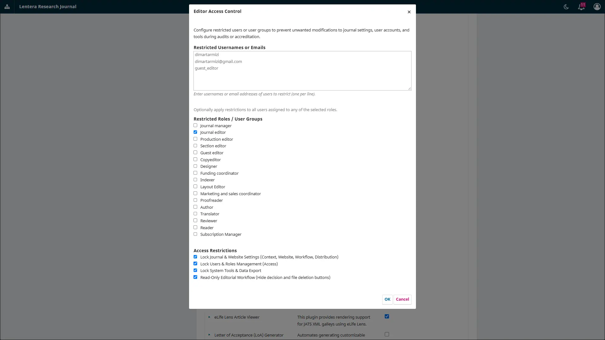

# OJS Editor Access Control Plugin

[](https://www.php.net/)
[](https://www.smarty.net/)
[](https://developer.mozilla.org/en-US/docs/Web/CSS)
[](https://developer.mozilla.org/en-US/docs/Web/HTML)
[](https://pkp.sfu.ca/ojs/)
[](LICENSE)

A granular security and role-restriction plugin for Open Journal Systems (OJS) 3.4. Designed to manage and restrict privileged access for specific accounts, guest editors, external reviewers, or auditors. Allows granting editorial workflow access while strictly blocking managerial settings, user impersonation, and unauthorized actions.

	

## Background Problem

In OJS, editorial roles frequently inherit managerial privileges (`ROLE_ID_MANAGER`). When granting accounts access to inspect or participate in submission workflows, users can inadvertently or deliberately:
- Access and modify journal, website, and distribution settings.
- View, manipulate, or impersonate other user accounts (`Login As`) in **Users & Roles**.
- Access system import/export tools.
- Accidentally record binding editorial decisions (Accept, Reject, Request Revisions) or delete manuscript files.

**Editor Access Control** solves this by enforcing targeted restrictions across routing, component handlers, REST APIs, and UI state without corrupting core database role assignments.

## Key Features

- **Granular Target Identification**:
  - Restrict specific user accounts by username or email address (one per line).
  - Or restrict all users assigned to selected roles / user groups.
  - Site Administrators are immune from accidental lockouts.
- **Multi-Layer Server-Side Protection**:
  - **Page Router Interception**: Intercepts direct URL routing to `admin`, `management/settings`, and `management/tools`, redirecting back to the submissions queue.
  - **Component Router Interception**: Hardens AJAX and Grid components against bypasses (blocking `grid.users.user.*`, `signInAsUser`, `editUser`, `deleteUser`, `grid.settings.*`, and `grid.tools.*`) with HTTP 403 JSON responses.
  - **REST API Interception**: Guards `/api/v1/users`, `/api/v1/contexts`, and workflow modification endpoints against unauthorized REST calls with HTTP 403 responses.
  - **Self-Protection**: Prevents restricted users from accessing or modifying plugin configuration via `manage()`.
- **Menu & UI State Sanitization**:
  - Automatically unsets **Settings** (Journal, Website, Workflow, Distribution) and **Users & Roles** from the backend navigation menu.
  - Locks out **Tools** and administrative menu items.
- **Read-Only Workflow Mode**:
  - Client-side hiding of decision, reviewer management, and file deletion controls in editorial workflows.
  - Server-side rejection of decision commits, reviewer unassignments, and file removals.
- **Bilingual Support**:
  - Fully translated in English (`en`) and Indonesian (`id`).

## System Requirements

- Open Journal Systems (OJS) 3.4.0
- PHP 8.0, 8.1, 8.2, 8.3, or 8.4

## Installation

1. Clone or copy the repository to your OJS plugins directory:
   ```bash
   git clone https://github.com/dimartarmizi/ojs-editor-access-control.git plugins/generic/editorAccessControl
   ```
   *Or extract the release archive into `plugins/generic/editorAccessControl`.*

2. Ensure correct file permissions:
   ```bash
   chmod -R 755 plugins/generic/editorAccessControl
   ```

3. Log in as Journal Manager or Site Administrator.

4. Navigate to **Settings > Website > Plugins > Installed Plugins**.

5. Under **Generic Plugins**, enable **Editor Access Control**.

6. Click the blue arrow next to the plugin name and select **Settings** to configure restricted usernames, roles, and protection rules.

## Authors & Maintainers

- **Author**: Dimar Tarmizi
- **Organization**: [Open Journal Center](https://github.com/openjournalcenter)
- **Repository**: [https://github.com/dimartarmizi/ojs-editor-access-control](https://github.com/dimartarmizi/ojs-editor-access-control)

## License

This plugin is licensed under the [GNU General Public License v3.0](LICENSE).
